<picture>
  <source media="(prefers-color-scheme: dark)" srcset="assets/hero-dark.svg">
  
</picture>

  <a href="https://www.linkedin.com/in/chirag-kumar-android/"><picture><source media="(prefers-color-scheme: dark)" srcset="assets/btn-linkedin-dark.svg"></picture></a>
  <a href="mailto:chiragkumar.studies@gmail.com"><picture><source media="(prefers-color-scheme: dark)" srcset="assets/btn-email-dark.svg"></picture></a>
  <a href="https://github.com/Chirag-22-10?tab=repositories"><picture><source media="(prefers-color-scheme: dark)" srcset="assets/btn-repos-dark.svg"></picture></a>

I build Android apps for people who work in the field: meter readers, supervisors, inspectors. They work with no signal, on cheap phones, all day. I write the camera flow, run the ML models on the phone, and keep every reading safe until the server confirms it. On the side I build Kotlin Multiplatform apps and talk to smart meters over Bluetooth.

 

<picture>
  <source media="(prefers-color-scheme: dark)" srcset="assets/h-work-dark.svg">
  
</picture>

At **Sujanix** I build **TrueRead**, the Android app meter readers use for a state electricity utility. A reader photographs the meter, the phone reads it, the reader confirms the reading, and the app gets it to the backend, even if the phone was offline all day.

<picture>
  <source media="(prefers-color-scheme: dark)" srcset="assets/fig01-reading-dark.svg">
  
</picture>

<picture>
  <source media="(prefers-color-scheme: dark)" srcset="assets/fig02-sync-dark.svg">
  
</picture>

| result | before | after | how |
|:--|--:|--:|:--|
| Where readings are made | server only | **on the phone** | 11 INT8 ONNX models in a separate Engine app, API as fallback |
| Reading upload | phone writes DynamoDB | **intake + failed APIs** | contract v2, validated on the phone before it is sent |
| Duplicate uploads | possible on retry | **none** | outbox keyed by `record_id`; a resend replaces its own row |
| Reader edits | whole reading | **only digits < 85 %** | per-digit confidence from the Engine's V4 reply |
| Analog OCR models in memory | 3 sessions | **1 session** | same SHA-256 → one ONNX session, ~28 MB and two decrypts saved |
| Model decrypt buffer | 8 KB | **1 MB** | each block was a Keystore call; a 14 MB model took 4–18 s |
| MD / PF photos | full size | **320 × 320** | resized before upload, like the kWh photo |

### Battle log

- **The slow unlock.** Models are stored encrypted with a key in the Android Keystore. Every `cipher.update()` is a call into the Keystore, and with 8 KB blocks one 14 MB model took 4–18 s to decrypt. Sizing the output to the file and reading 1 MB blocks fixed the first-load wait.
- **The model loaded three times.** The short, medium and long analog OCR models turned out to be the same file. The Engine now matches models by SHA-256 and builds one ONNX session for all three, saving ~28 MB and two decrypts.
- **The bad update.** A broken model set used to fail at the first reading in the field. Now the Engine loads and runs every model once while installing, and any failure rolls back to the previous set before a reader ever sees it.
- **The answer that wasn't JSON.** The new intake API replied in XML (it's a queue), and the app was parsing JSON. It now reads the `MessageId` from the XML, and debug builds can route a reading to the failed API to test the whole path.
- **The wrong discom.** Readers sometimes opened a North consumer in the South billing app. Instead of a confusing error, the app now shows which discom the consumer belongs to and stops there.

<b>How models ship</b>: a separate Engine app, verified and encrypted model sets, rollback (Fig 03)

 

<picture>
  <source media="(prefers-color-scheme: dark)" srcset="assets/fig03-models-dark.svg">
  
</picture>

- **A separate Engine app:** the models and ONNX Runtime live in their own APK, reached over AIDL. The interface only ever grows by appending methods (V2 → V3 → V4), so an older Engine keeps working with a newer app.
- **Verified, then encrypted:** each downloaded model is checked for size and SHA-256, then stored with AES-GCM using a Keystore key. It is decrypted in memory only, and the bytes are wiped once the session is built.
- **Two paths, one answer:** the router uses the configured path first (from Remote Config) and allows one fallback. After 3 failures in a row, a path is tried second for 5 minutes, so readers don't wait for a server that is down.
- **Sync rules you can test:** background sync always sends. The foreground sends when the batch size is reached or a reading is 2 hours old. Billing is blocked while 20 or more readings are waiting. The rules live in one object with unit tests.

<b>Where these numbers come from</b>

 

- **6 apps:** TrueRead (South, North and the link app), the Supervisor app, TeamXel (attendance with on-device face verification) and the CPDL billing UI, all built at Sujanix.
- **11 models:** the Engine's on-device pipeline (spoof, meter presence, dial detection, meter classifier, parameter, svtrv2 s/m/l and analog OCR s/m/l). The models come from Sujanix's ML team; I integrate, ship and update them on the phone.
- **124 commits:** my commits to the TrueRead app from August to November 2026.
- **Before and after:** taken from the code and the commit history. The work repos belong to my employer and are private.

 

<picture>
  <source media="(prefers-color-scheme: dark)" srcset="assets/h-hardware-dark.svg">
  
</picture>

### [TruereadBle](https://github.com/Chirag-22-10/TruereadBle) · reading smart meters over Bluetooth

Smart meters can also be read directly, without a camera. This Kotlin app talks **DLMS/COSEM** to electricity meters over Bluetooth and runs the full **IEC 62056-46 HDLC** session itself.

- **Both radios at once.** The scanner finds meters over BLE and Classic Bluetooth at the same time. One `BluetoothChannel` interface hides whether it's GATT or an SPP socket.
- **The whole handshake.** SNRM → UA, AARQ with LOW authentication → AARE, a GET per OBIS code, then DISC. Responses that span several HDLC blocks are put back together.
- **What comes out.** 13 months of billing history, tariff-zone energy T1–T6 (kWh and kVAh), max demand with its timestamp, and voltage, current, power factor and power.
- **Built on.** Gurux DLMS, Kotlin coroutines, MVVM with StateFlow, and the last good reading kept for offline use.

<b>Fig 04</b>: every frame between the phone and the meter

 

<picture>
  <source media="(prefers-color-scheme: dark)" srcset="assets/fig04-dlms-dark.svg">
  
</picture>

- **Billing profile:** rows 0–11 are closed months, row 12 is the current period. The app reverses them so the latest comes first and labels the current one.
- **Meter setup:** client address 32 (public client), server address 1, LOW authentication with the meter's password.

 

<picture>
  <source media="(prefers-color-scheme: dark)" srcset="assets/h-quests-dark.svg">
  
</picture>

### [Room-Splits](https://github.com/Chirag-22-10/Room-Splits) · split expenses on Android, iOS and the web

An expense-sharing app for roommates, trips and friends, written once in **Kotlin Multiplatform** and **Compose Multiplatform**.

- **One codebase, three targets.** Android, iOS and Web (Wasm) share the UI and the logic: domain, data and MVI stores, wired with Koin.
- **Offline first.** SQLDelight on the device, Ktor client for sync, and a Ktor server on PostgreSQL.
- **The hard part is the math.** Equal, exact, percentage and share splits, balances with debt simplification, and a settle-up flow.
- **Status.** Just started. The roadmap has six phases, from the KMP foundation to offline sync, export and multi-currency. The parts not built yet are drawn dashed.

<b>Fig 05</b>: how Room-Splits is laid out

 

<picture>
  <source media="(prefers-color-scheme: dark)" srcset="assets/fig05-splits-dark.svg">
  
</picture>

### [FieldProof](https://github.com/spacedrift-in/fieldproof-android) · field inspections that work in airplane mode

Inspection evidence ends up scattered across photos and chat messages. FieldProof keeps the inspection, the checklist and the photos together on the phone, syncs them when it can, and never silently loses any of it.

- **Room is the truth.** Inspections, checklist outcomes (pass / fail / N/A with notes) and CameraX photos survive process death while offline.
- **Exactly once, in effect.** WorkManager retries are at-least-once, so every upload carries a stable `Idempotency-Key` and the server dedupes on it.
- **Honest conflicts.** Concurrent edits are flagged for review using server versions, never silently overwritten.
- **Tested.** 177 Android tests (JVM and instrumented) and 95 backend tests, a CI emulator lane and a signed release pipeline. The backend is FastAPI on PostgreSQL and renders PDF reports.

<b>Fig 06</b>: FieldProof's sync state machine

 

<picture>
  <source media="(prefers-color-scheme: dark)" srcset="assets/fig06-fieldproof-dark.svg">
  
</picture>

 

<picture>
  <source media="(prefers-color-scheme: dark)" srcset="assets/h-loadout-dark.svg">
  
</picture>

<picture>
  <source media="(prefers-color-scheme: dark)" srcset="assets/loadout-dark.svg">
  
</picture>

 

<picture>
  <source media="(prefers-color-scheme: dark)" srcset="assets/h-career-dark.svg">
  
</picture>

| when | role | where | what |
|:--|:--|:--|:--|
| **2026 → now** | Software engineer | Sujanix | TrueRead field apps: camera → on-device models → offline sync |

 

<picture>
  <source media="(prefers-color-scheme: dark)" srcset="assets/h-rules-dark.svg">
  
</picture>

1. A reading isn't done until the server confirms it.
2. Never drop data silently.
3. Assume the phone is offline.
4. Fail while loading, not at the first reading.
5. Interfaces only grow: append, never reorder.
6. Test on the cheapest phone in the field.
7. Delete more than you add.

 

  Works in airplane mode. Syncs when it can. 
  <a href="https://www.linkedin.com/in/chirag-kumar-android/">LinkedIn</a> · <a href="mailto:chiragkumar.studies@gmail.com">Email</a> · <a href="https://github.com/Chirag-22-10?tab=repositories">Repositories</a>

